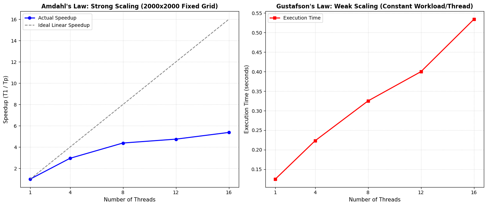

# OpenMP 2D Heat Transfer Simulation

This repository contains a High-Performance Computing (HPC) simulation that numerically solves Laplace’s equation for thermal distribution across a 2D printed circuit board. The project utilizes an explicit finite-difference method parallelized with OpenMP in C++, executed on a 16-core Linux cluster via the SLURM workload manager.

## Key Features
* **OpenMP Parallelization:** Utilizes `#pragma omp parallel for collapse(2)` for static worksharing, optimizing L1/L2 cache locality across symmetric multiprocessor (SMP) architectures.
* **Race Condition Guarding:** Implements a dual-array staging strategy with implicit OpenMP loop barriers to prevent read-after-write hazards during spatial domain consensus.
* **Dynamic Convergence Detection:** Features a parallel arithmetic reduction (`reduction(+:nconverged)`) to halt execution identically across all threads once a global thermal equilibrium tolerance ($\epsilon = 10^{-5}$) is achieved.
* **FITS Image Generation:** Integrates the NASA HEASARC `cfitsio` library to output high-resolution FITS (`.fit`) thermal maps for SAOImage DS9 visualization.

## Repository Contents
* `heat_omp.cpp`: Core parallel simulation source code.
* `makefile`: GNU C++ compilation directives including `-fopenmp`, `-O3`, and CFITSIO linking.
* `job_ass3.sh`: SLURM batch execution script for automated thread scaling.
* `plot_scaling.py`: Python script utilizing Matplotlib to generate scaling visualizations.

## Performance Analysis
The simulation was benchmarked on a 16-core Linux SMP node to evaluate parallel scaling efficiency.

* **Strong Scaling (Amdahl's Law):** Evaluated on a fixed $2000 \times 2000$ grid. The simulation demonstrates significant execution time reduction scaling from 1 to 4 threads, eventually encountering sequential overhead limits at 16 threads due to OpenMP barrier synchronizations and reduction consolidations.
* **Weak Scaling (Gustafson's Law):** Evaluated with a constant workload of $160,000$ pixels per thread. As grid dimensions scale up, the physical propagation distance required for the heat to reach global convergence expands exponentially, resulting in the expected non-linear runtime scaling characteristic of iterative numerical relaxation solvers.

**Author** 
Subrota Debnath 
Master of Information Sciences 
Massey University
